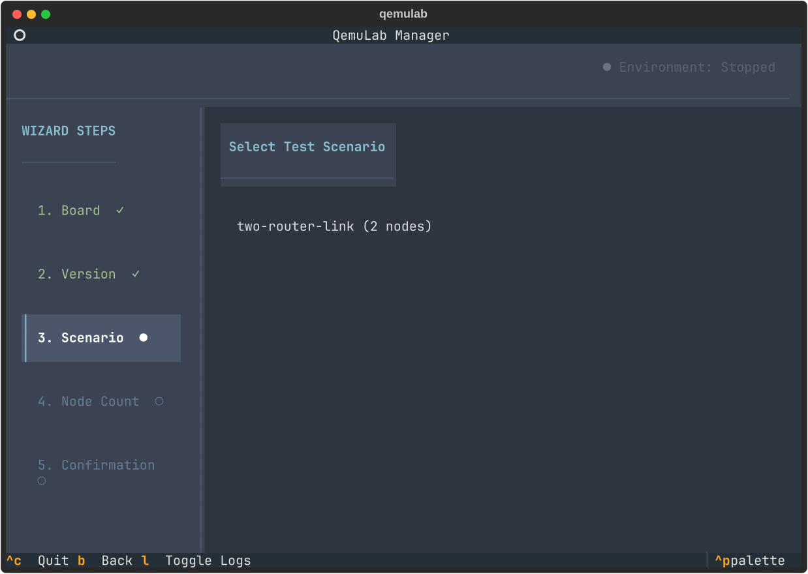
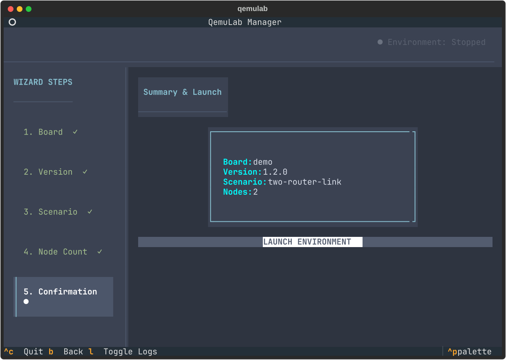

<!-- brand:header:start -->
<picture>
  <source media="(prefers-color-scheme: dark)" srcset="assets/brand/header-8d3e543c-dark.svg">
  
</picture>
<!-- brand:header:end -->

<!-- badges:start -->
[](https://www.repostatus.org/#wip)
[](https://github.com/JonathanTSilva/qemulab/actions/workflows/ci.yml)
[](https://codecov.io/gh/JonathanTSilva/qemulab)
[](https://sonarcloud.io/summary/new_code?id=JonathanTSilva_qemulab)
[](https://scorecard.dev/viewer/?uri=github.com/JonathanTSilva/qemulab)
[](LICENSE)
[](https://codespaces.new/JonathanTSilva/qemulab)
<!-- badges:end -->

**Spin up a multi-node QEMU network lab from your terminal.** Pick a board, a firmware version and a scenario, and qemulab builds the network, boots every node in its own tmux pane and loads each node's configuration for you.

<p align="center">
  
  
</p>

*The wizard picks up scenarios from disk (left) and confirms the whole lab before launch (right). The images here are empty placeholders.*

## What it is

A terminal UI built with [Textual](https://textual.textualize.io/) that orchestrates small QEMU labs of network appliances. Image layout, guest login and config-mode commands are all configurable, so it works with any kernel and initrd pair. The project is a work in progress.

- **A five-step wizard.** Board, image version, scenario, node count, then a summary to confirm.
- **The network, done for you.** It provisions the Linux bridges and tap interfaces the nodes need.
- **Every node in view.** Guests boot side by side in tmux panes, and the TUI shows environment status and logs.
- **Scenarios as plain files.** A `scenario.json` plus one `cfg_dutN` file per node. qemulab types each node's configuration into its console.
- **Careful with sudo and secrets.** It asks for your sudo password once, never types it into a pane when the sudo timestamp can be shared, and ships no credentials by default.
- **A cleanup script.** `scripts/cleanup_qemulab.sh` removes leftover QEMU processes, the tmux session and the lab interfaces.

## Quick start

```sh
git clone https://github.com/JonathanTSilva/qemulab.git
cd qemulab
uv sync
uv run -m qemulab check    # verify the host can run a lab
```

Running a lab needs `qemu-system-x86_64`, `ip`, `tmux`, `sudo` and `/dev/kvm` on the host, plus your own kernel and initrd images. To try the bundled example scenario:

```sh
QEMULAB_SCENARIOS_PATH="$PWD/scenarios" uv run -m qemulab start
```

You can also open the repository in a dev container or GitHub Codespaces to work on the code and run the tests with `uv run pytest`. A lab itself needs a host with KVM.

## Usage

```sh
uv run -m qemulab start    # launch the TUI wizard
uv run -m qemulab check    # verify host requirements
```

`start` takes `--verbose`, `--config <file>` and `--force` (skip the host checks). In the TUI, `Q` quits, `B` goes back a step, `L` toggles the log view and `S` saves the logs.

### Images

By default qemulab looks for images under `~/qemulab/images`:

```text
~/qemulab/images/<board>/images/<board>-bzImage-<version>
~/qemulab/images/<board>/images/<board>-rootfs.cpio-<version>
```

Every part of this (directory pattern, file name templates, base path) is a setting.

### Scenarios

A scenario is a directory with a `scenario.json` and one `cfg_dutN` file per node, under `${XDG_CONFIG_HOME:-~/.config}/qemulab/scenarios` by default. See [`scenarios/two-router-link`](scenarios/two-router-link) for a minimal example that uses addresses from the RFC 5737 documentation range (192.0.2.0/24). Scenario commands are typed into guest consoles, so point `scenarios_path` only at a directory that you alone can write to.

Sudo handling, image and scenario settings, cleanup and the config file are covered in the [configuration guide](docs/CONFIGURATION.md).

## Docs

More guides live in [`docs/`](docs): [configuration](docs/CONFIGURATION.md), [quick reference](docs/QUICK_REFERENCE.md),
[navigation](docs/NAVIGATION_AND_STATUS_GUIDE.md), [cleanup](docs/CLEANUP_AND_EXIT_GUIDE.md),
[troubleshooting](docs/TROUBLESHOOTING.md), [FAQ](docs/FAQ.md) and [testing](docs/TESTING.md).
The conventions this repository follows are in the
[handbook](https://github.com/JonathanTSilva/.github/blob/main/handbook/README.md).

## Contributing

See the [contributing guide](https://github.com/JonathanTSilva/.github/blob/main/CONTRIBUTING.md).
Branches are named `<type>/<issue>-<slug>`, commits and PR titles follow Conventional Commits,
and PRs are squash-merged.

## License

MIT. See [LICENSE](LICENSE).

<!-- brand:footer:start -->
<p align="right"><a href="https://www.jontobias.com"><picture>
  <source media="(prefers-color-scheme: dark)" srcset="https://raw.githubusercontent.com/JonathanTSilva/.github/main/assets/brand/jontobias-dark.svg">
  
</picture></a></p>
<!-- brand:footer:end -->
